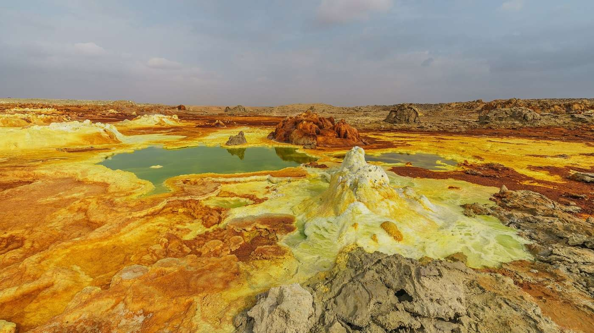

# RIFTLENS

**Ethiopia's Afar rift is Mars happening in real time. RIFTLENS measures it, and protects the people living on it.**


<sub>Dallol, Afar Region, Ethiopia. Photo: A. Savin, FAL licence, via Wikimedia Commons.</sub>

Team **N0xCod3** for the [NASA Space Apps Challenge 2026](https://www.spaceappschallenge.org/2026/), Addis Ababa local event, 14 to 15 November 2026, Shaggar Institute of Technology.

**Challenge:** [Identify Earth Locations that Analog the Permanent Moon Base Locations and Mars](https://www.spaceappschallenge.org/2026/challenges/permanent-moon-base-locations-and-mars/)

## The idea

NASA tests equipment for the Moon and Mars at places on Earth that behave like them. The usual list is Atacama, Iceland, Devon Island. One of the strongest candidates sits in Ethiopia and has barely been characterised with data.

Afar has Dallol, an acidic, hypersaline hydrothermal field astrobiologists use to study life at its limits. It has Erta Ale, one of the few persistent lava lakes on Earth. And it is actively splitting apart. Between December 2024 and early 2025 a magma intrusion under Fentale and Dofan caused thousands of earthquakes, cracked the Addis to Djibouti road and railway, and displaced tens of thousands of people. Satellite radar saw the ground move before the cracks opened.

RIFTLENS is one web map with three layers that turn that into evidence.

## The three layers

### 1. Analog Index
A similarity score between any place on Earth and two targets: Jezero crater on Mars and the lunar south pole near Shackleton crater. Built from terrain, surface temperature, aridity, albedo, minerals and geological activity. Each site gets a scorecard showing where the analogy holds and where it breaks, since Earth cannot reproduce lunar gravity, vacuum, radiation or the thin Martian atmosphere.

### 2. The Dance (radar)
NISAR and Sentinel-1 radar coherence and deformation over the Awash to Fentale corridor, 2024 to 2026, on a time slider. Rifting by dyke intrusion is the same process that formed Cerberus Fossae on Mars. The same layer works as a hazard view for the railway, the Kesem sugar estate and the Aluto and Tulu Moye geothermal fields.

### 3. The Pulse (thermal)
A harmonised MODIS and VIIRS hotspot record from 2000 to today for any area drawn on the map. Separates permanent volcanic heat (Erta Ale, Dallol) from vegetation fires (Bale, Simien), shows a month by year calendar, flags anomalies against the long term median, and exports CSV.

## Data

| Layer | Dataset | Source |
|---|---|---|
| Analog | SRTM / NASADEM elevation | [Earthdata Search](https://search.earthdata.nasa.gov) |
| Analog | MODIS LST (MOD11), NDVI (MOD13), albedo (MCD43) | [AppEEARS](https://appeears.earthdatacloud.nasa.gov) |
| Analog | ASTER GDEM and surface reflectance | [Earthdata Search](https://search.earthdata.nasa.gov) |
| Analog | GPM IMERG rainfall | [Giovanni](https://giovanni.gsfc.nasa.gov) |
| Mars target | MOLA elevation, THEMIS infrared | [USGS Astrogeology](https://astrogeology.usgs.gov/search), [Mars Trek](https://trek.nasa.gov/mars) |
| Moon target | LOLA elevation, Diviner temperature | [PDS Geosciences](https://pds-geosciences.wustl.edu), [Moon Trek](https://trek.nasa.gov/moon) |
| Radar | Sentinel-1, NISAR, HyP3 on demand InSAR | [ASF Vertex](https://search.asf.alaska.edu) |
| Radar | ARIA interferograms | [ARIA](https://aria-share.jpl.nasa.gov) |
| Thermal | MODIS C6.1 and VIIRS active fire | [FIRMS](https://firms.modaps.eosdis.nasa.gov/download) |
| Context | Roads, railway, towns | [OpenStreetMap / Geofabrik](https://download.geofabrik.de/africa/ethiopia.html) |
| Context | Volcano records | [Smithsonian GVP](https://volcano.si.edu) |

Full notes in [docs/DATA_SOURCES.md](docs/DATA_SOURCES.md). Method details in [docs/PLAN.md](docs/PLAN.md).

## Study areas

| Site | What it is | Analog role |
|---|---|---|
| Dallol | Hydrothermal salt and sulphur field | Mars hydrothermal chemistry, extremophiles |
| Erta Ale | Shield volcano with lava lake | Volcanic process, persistent thermal anomaly |
| Danakil salt flats | Below sea level evaporite basin | Martian evaporites and salts |
| Fentale and Dofan | 2024 to 2025 dyke intrusion | Active rifting, Cerberus Fossae |

Benchmarks for comparison: Atacama, Devon Island, Iceland.

## Repository layout

```
app/              web map (MapLibre GL JS or Leaflet, static hosting)
data/raw/         downloads, not tracked in git
data/processed/   clipped and harmonised layers the app reads
docs/             plan and data sources
notebooks/        01_analog_index, 02_rift_radar, 03_fire_calendar
pitch/            slides, image bank and credits
```

## Status

- [x] Concept, data plan, image bank
- [ ] Analog Index score and site scorecards
- [ ] Radar coherence stack over Fentale
- [ ] Harmonised MODIS and VIIRS calendar
- [ ] Web map with all three layers
- [ ] Demo and project page submitted

## Team

N0xCod3, Addis Ababa.

## Credits

Images in `pitch/images` are public domain (NASA, USGS) or Creative Commons (Wikimedia Commons, ESA). Licence and source for each one are in [pitch/images/CREDITS.md](pitch/images/CREDITS.md).

## Licence

[MIT](LICENSE)
